# Architecture of the DSP library

The library is a binary-compatible port of the `dsplibs` binary (a closed-source i386 object) that shipped with slmodem.
The primary goal of the port is 64-bit compatibility.  Its structure follows `dsplibs`: the same functions, the same objects (at the
same i386 member offsets), the same call graph.  This page says where things are and which conventions the code uses; `docs/bugs.md` lists the
defects and quirks inherited from `dsplibs`.

## How slmodemd uses it

slmodemd calls 22 entry points, each declared with its own `extern` line in slmodemd's sources (modem.c, modem_at.c, modem_main.c,
modem_test.c); no library header is included by slmodemd:

* `prop_dp_init` / `prop_dp_exit` (src/core/dp_registry.c) register the data pumps with slmodemd (`modem_dp_register`): call progress
  (src/callprog/dp_call.c), Bell 103 / V.21 (src/fsk/dp_v21_b103.c), V.22 (src/v22/dp_v22.c), V.23 (src/fsk/dp_v23.c), V.32 (src/v32/dp_v32.c),
  V.8 (src/v8/dp_v8.c), V.34 / V.90 / V.92 / K56Flex (src/vpcm/dp_vpcm.cpp).  slmodemd then drives each pump through its `struct dp_operations`
  (create / delete / process / ...); the shared dp plumbing is src/core/dp_wrapper.c, the runtime object src/core/dp_runtime.c.
* `dp_runtime_create` / `_delete`, `dcr_create` / `_delete` / `_process` and `RD_create` / `_delete` / `_process` / `_ring_details` (the
  ring-detector wrapper over src/ring) in src/core/dp_runtime.c, `CID_create` / `_delete` / `_process` (src/cid/cid_modem.c), `VOICE_create` /
  `_delete` / `_process` / `_command` (src/voice/voice_api.c), `FAX_create` / `_delete` / `_process` / `FAX_class1_command` (src/fax/fax_api.c).

## Modules

| module | role |
|---|---|
| `core` | dp registry, dp wrapper / runtime, the table handles (`dsp_table_handles.*`), the RcFixed resampler, and the shared support headers `dsp_access.h`, `dsp_asm.h`, `dsp_math.h`, `dsp_cxx.h`, `dp_glue.h` |
| `fpm` | the FPM_* fixed-point toolkit (AGC, IIR, MRF, MTD, FSD / FSM, tone generator, math); used by every classic modem |
| `ring`, `tone`, `callprog`, `cid` | ring detector; the tone-detect core shared by call progress and voice; call progress + dialer; caller ID |
| `fsk`, `v8`, `v22`, `v32` | Bell 103 / V.21 and V.23; V.8; V.22 / V.22bis / Bell 212A; V.32 / V.32bis (engine, equalizer, timing, echo canceller, Viterbi) |
| `v34` | the V.34 modem itself: the plain-C signal path ("tiers", `v34_*.c`), its tables, the generated C views of the shared objects (`v34_*_view.h`, `v34_subobjects.h`) and the C++ object `tagV34Object` (`v34_object.h`) |
| `v34/handshake` | the 26 pieces of `dsplibs`'s single 61.5 KB function `v34handshak` (`v34_hs_*.cpp`, compiled with `V04_DEFS`) |
| `dsp` | the generic C++ DSP classes (integer templates, float filters, window / FFT / PSD, tone detectors, resampler) |
| `vpcm` | the V.34 / PCM session layer shared by V.34 and V.90 / V.92 (VPcmV34Create / Progress / datapump / wrappers, `dp_vpcm.cpp`, and the three plain-C files that define the rest of the VPcmV34* API on the `V34Obj` view: `v34_api.c`, `v34_modem_init.c`, `v34_handshake_init.c`) and the V.90 / V.92 / K56Flex classes (`v90_*`, `v92_*`, `pcm_*`, `vpcm_flo_modem*`) |
| `fax`, `voice` | fax data pumps, T.30 / HDLC and class 1; the voice engine, DTMF, tones, FDSP |

C modules are C (gnu99), the classes of `dsp`, `vpcm` and `v34/handshake` are C++ without exceptions, RTTI or libstdc++.  Every file name
carries its module or protocol prefix and is unique in the tree; a header in the same directory is included bare, one in another module
by its path below `src/` (`#include "fpm/fpm.h"`, `-Isrc`).

## Signal chains: transmit and receive

This section follows the samples and bits through each data pump: which source module does which DSP block, in what order.  The diagrams are
Mermaid (GitHub renders them); node labels name the function that does the work, with its file in the tables underneath.  Every stage
named here was read in the source; where a stage does not exist for a modem, the text says so.

### The common frame: from `process()` to the engine

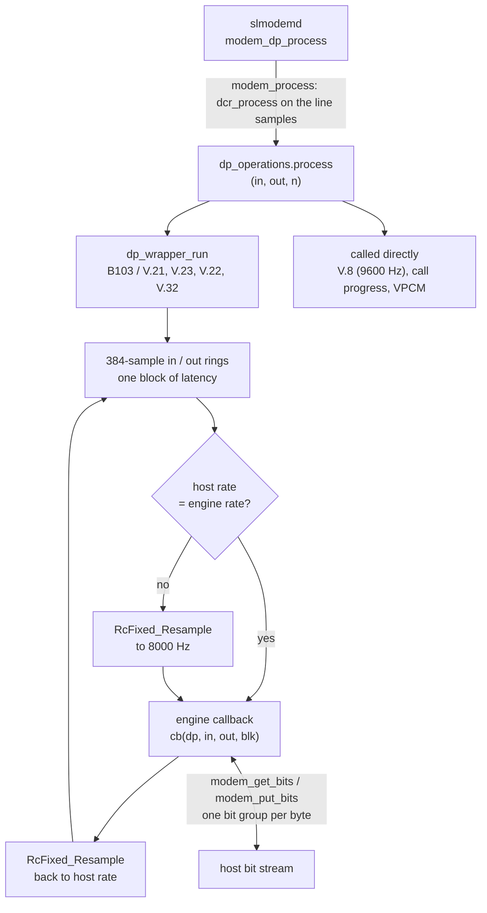

* **Registration.**  `prop_dp_init` (src/core/dp_registry.c) registers seven pumps: call progress, Bell 103 / V.21, V.22, V.23, V.32, V.8 and
  the VPCM pump that serves V.34, V.90 and V.92 (src/vpcm/dp_vpcm.cpp registers one `vpcm_op` for all three).  Fax and voice are not pumps: slmodemd
  reaches them through `FAX_*` and `VOICE_*` directly.
* **Block shape.**  `dp_wrapper_create` (src/core/dp_wrapper.c) derives the block length from the host fragment and rate.  The engines work on
  160 samples at 8000 Hz (Bell 103, V.23, V.22) or 40 samples at 8000 Hz (V.32).  The two rings are 384 samples; the output ring starts with one
  block of silence.  `RcFixed` (src/core/rcfixed_resampler.c) converts 8000 / 9600 / 48000 Hz with a polyphase FIR.
* **Bits.**  The bit group per call is 1 bit (Bell 103, V.23), 2 or 4 (V.22) or rate / 2400 (V.32).  Each pump's glue file (`dp_v21_b103.c`,
  `dp_v23.c`, `dp_v22.c`, `dp_v32.c`) widens TX bytes before the engine and packs RX groups after it.
* **Echo and duplex** are not the wrapper's business.  They are done inside each engine: frequency plan and band-pass for the FSK modems, a
  channel-specific filter for V.22, an adaptive echo canceller for V.32 and V.34.

### The shared DSP toolkit (`fpm`)

The classic modems (Bell 103, V.21, V.23, V.22, V.32 and the fax modems) are built from the same fixed-point blocks:

| block | role | used by |
|---|---|---|
| `FPM_AGC_agc` (fpm_agc.c) | block AGC: per-block RMS, squelch, Q15 gain; `Freeze` / `Release` hold the gain | every receiver |
| `FPM_iir_filt` / `_II` (fpm_iir.c) | biquad cascade (`_II`: in place, block form) | FSK, V.22 originate side, V.23, fax |
| `FPM_MRF_filter` (fpm_mrf.c) | polyphase FIR rate converter (ratio = phases / step) | FSK TX shaper and RX filter, V.22 / V.32 RX, fax V.21 |
| `FPM_MTD_detect` (fpm_mtd.c) | energy-ratio tone detector | handshake, V.32, fax tone killer |
| `FPM_FSM_modulate` / `FPM_FSD_demodulate` (fpm_fsm.c, fpm_fsd.c) | FSK modulator (continuous phase) and demodulator (FIR, delay-multiply, low-pass, slicer, bit clock) | Bell 103, V.21, fax V.21 |
| `FPM_TONE_*` (fpm_tone.c) | tone generator / detector / killer, `generate_demod` for a local oscillator | V.23, handshakes |
| `FPM_rms`, `FPM_div`, `FPM_sqrt_dp`, `FPM_phasor` (fpm_math.c) | math kernels | all |

The PSK / QAM modems (V.22, V.32, fax V.27ter / V.29 / V.17) share the same block *names* in their own directories: `SDM` scrambler, `SMC`
symbol mapper and encoder, `PPS` pulse-shaping filter, `SRE` timing recovery, `FSE` fractionally spaced equaliser, `ECC` echo canceller, `VTB` Viterbi decoder.

### Bell 103 / V.21 and V.23 (`fsk`)

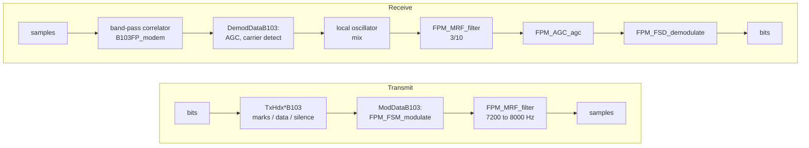

* There is no scrambler, no symbol mapper, no equaliser and no symbol timing recovery: the only clock is the bit clock inside `FPM_FSD`.
* **Entry:** `b103_process` (dp_v21_b103.c) → `B103FP_modem` (v21_b103.c), a flat function that runs the TX handler and then the RX handler
  stored in the engine object; a mode table selects the handshake phase.
* **V.23** (v23.c): state 0 sends the 2100 Hz answer tone (`FPM_TONE_generate`), state 1 is 50 ms of silence, state 2 runs the modem.  TX is a tone
  generator retuned per bit (`FPM_TONE_set_freq`, `FPM_TONE_generate_demod`) with no pulse shaping; the forward channel (1200 baud) receives with IIR → `FPM_MRF_filter` →
  AGC → `FPM_FSD_demodulate`; the backward channel (75 baud, `BwChDem_Progress`) compares the mark and space energies of two IIR filters per 26 / 27 sample
  block and debounces over four blocks.

### V.22 / V.22bis / Bell 212A (`v22`)

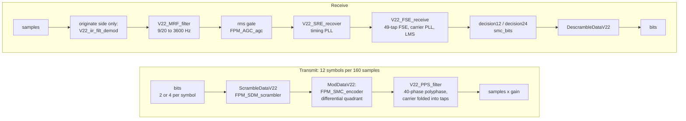

* **Entry:** `v22_process` (dp_v22.c) → `V22FP_modem` (v22_engine.c), which dispatches on the engine state to `v22_data`, `v22_originate`, `v22_answer`,
  `v22_local_loop`, the two remote-loopback handlers or `v22_retrain` (v22_call_setup.c has the `tx_chain` / `rx_chain` they share).
* The "mapper" is the `imap` / `qmap` lookup inside `V22_PPS_filter`, not a separate stage; there is no trellis code and no echo canceller.
* The answer side has no explicit demodulator: the equaliser (`V22_FSE_receive`) removes the carrier.

### V.32 / V.32bis (`v32`)

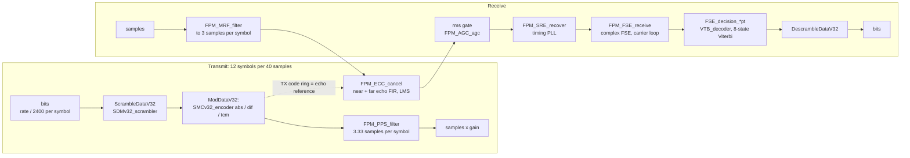

* **Entry:** `v32_process` (dp_v32.c) → `V32FP_modem` (v32_engine.c) → one of the `V32_PROTOCOL_PORT[role]` handlers: roles 0, 1, 2, 4 and 5 run `v32_handshake`
  (`V32RxHdxModem`, then `V32TxHdxModem`), role 6 runs `v32_data` (scramble → demodulate → modulate → descramble, plus the retrain and rate renegotiation detectors).
  The next-state tables (`V32OrgNextState`, `V32AnsNextState`, ...) move a role between phases.
* **Encoder choice:** `SMCv32_encoder_abs` (handshake, absolute phase), `_dif` (4800 and non-trellis 9600) and `_tcm` (trellis: 7200, trellis 9600, 12000, 14400).
* **Echo canceller:** `FPM_ECC_cancel` (v32_echo_canceller.c) runs in place on the filtered input, with near- and far-echo FIRs fed from the *transmit code
  ring*, three rotating tap sets (one per sample phase) and an LMS update while the adapt flags are set.
* **Decision callbacks** follow the training sequence: `FSE_decision_AB`, `_CD`, `_trn`, `_4pt` (handshake chain), then `_16pt` (9600), `_32pt` (9600 trellis), `_16Tpt` (7200), `_64pt` (12000), `_128pt` (14400).

### V.34 (`v34`, `v34/handshake`, `vpcm`)

V.34 is the one modem that is a single large object (`tagV34Object`) driven in two modes by the same per-sample loop.

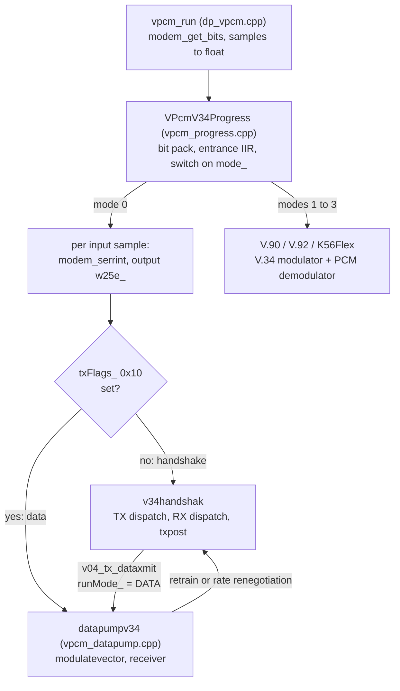

**Transmit** (per symbol):

```mermaid
flowchart LR
    a["host bits<br/>16 per txWords_ word"] --> b["getFrame<br/>scrambleGPC / GPA"] --> c["modulatevector:<br/>shell mapper,<br/>ring numbers"] --> d["pair + quarter table<br/>differential rotation"] --> e["precoder<br/>6-tap complex"] --> f["trellis encoder<br/>64-state or LFSR form"] --> g["V34nlencoder<br/>non-linear coding, optional"] --> h["txmit:<br/>V34ModulatorProcess<br/>polyphase interpolation,<br/>carrier mix, output FIR"] --> i["x txGain_<br/>(settxlevel)"] --> j["V34EchoPreFilter<br/>TX ring"] --> k["samples"]
```

**Receive** (per sample, then per symbol):

```mermaid
flowchart LR
    a["samples"] --> b["modem_serrint:<br/>DC filter,<br/>near/far echo estimate"] --> c["V34HilbertFilter<br/>I/Q ring"] --> d["V34demodulate<br/>AGC, carrier mix"] --> e["receiver():<br/>interpolate at timing phase,<br/>V34TimingFilter"] --> f["V34EqualizerFilter<br/>80-tap complex"] --> g["decision + carrier PLL<br/>rx_phase_error, rx_tail,<br/>V34EqualizerAdapt"] --> h["decoderv34:<br/>16-state Viterbi,<br/>traceback"] --> i["shellDemapper,<br/>putFrame<br/>descrambleGPC / GPA"] --> j["rxWords_ to host bits"]
```

| block | where |
|---|---|
| frame / scramble (`getFrame`, `putFrame`, `scrambleGP*`) | v34_tx_symbol.c, v34_frame_decoder.c, v34_init.c |
| shell mapper, precoder, trellis encoder, `modulatevector`, `txmit` | v34_modulator.c |
| output level (`settxlevel`) | v34_tx_level.c |
| polyphase modulator, demodulator, AGC (`V34ModulatorProcess`, `V34demodulate`, `V34agc`) | v34_agc_demod.c |
| `modem_serrint`, echo filter, Hilbert filter, `rxtiming` | v34_echo_rx_timing.c |
| `receiver`, equaliser, decision, carrier PLL | v34_receiver.c |
| Viterbi decoder, shell demapper (`decoderv34`, `demapFrame`) | v34_frame_decoder.c |
| tone / DFT / FSK detectors | v34_detectors.c |
| probe-signal analysis and rate choice (`probeselect`) | v34_probe_select.c |
| leaf kernels (filters, FFT-like helpers) | v34_dsp_primitives.c |

* **Handshake pieces** (`v34/handshake`, 26 `v34_hs_*.cpp` files that together are `dsplibs`'s `v34handshak`).  `v34handshak` runs `v04z_tx_dispatch` while the
  TX block is not full, then `v04z_rx_dispatch`, then `v04_txpost`; the states are one enum (`V34HsState`, 87 values) shared by the TX state, the RX state and
  the `mst_` micro-states.  By function, in the order the call proceeds: INFO0 / INFO1 exchange (DPSK at 600 baud: `tx_dpsk`, `rx_det_info`), probing (`tx_l1`, `rx_l1`
  with 25 DFT records, `rx_det_ab`, `probeselect`), training segments (S, S-bar, PP, TRN: `tx_small`, `tx_mid`, `tx_trnseg4`), rate choice and the MP message (`tx_trnseg4a`, `tx_xmitmp`), power level
  (`settxlevel`) and the switch to data (`tx_small` at DATAXMIT).  The phase names in the code are not the ITU phase numbers.  The V.8 phase before all of this is the separate `v8` pump.
* **Session layer** (`vpcm`): `v34handshakinit` (v34_handshake_init.c) resets the object for start, retrain, local or remote rate renegotiation; `v34modeminit`
  (v34_modem_init.c) sets 2400 baud, the 600 baud DPSK modulator and the tone detector; v34_api.c is the rest of the `VPcmV34*` API.  `vpcm_run` runs a link-state
  machine on the status `VPcmV34Progress` returns (4 or 5 = link up).
* **The generic classes in `dsp`** are used by the V.90 / V.92 engines; the plain V.34 path uses its own C kernels and touches only the entrance filter
  (`GenericIIR`) and the ANSam detector.

### V.90 / V.92 / K56Flex (`vpcm`)

Only the analog (client) side is built.  So the receive chain is the PCM downstream demodulator, and the transmit chain is the V.34 modulator in V.90 and the V.92 upstream modulator in V.92; the digital-side
modulator (`V90Modulator`, `V90Mapper`) is compiled and differential-tested but nothing in the pump calls it.  K56Flex is a stub that asks for a retrain.

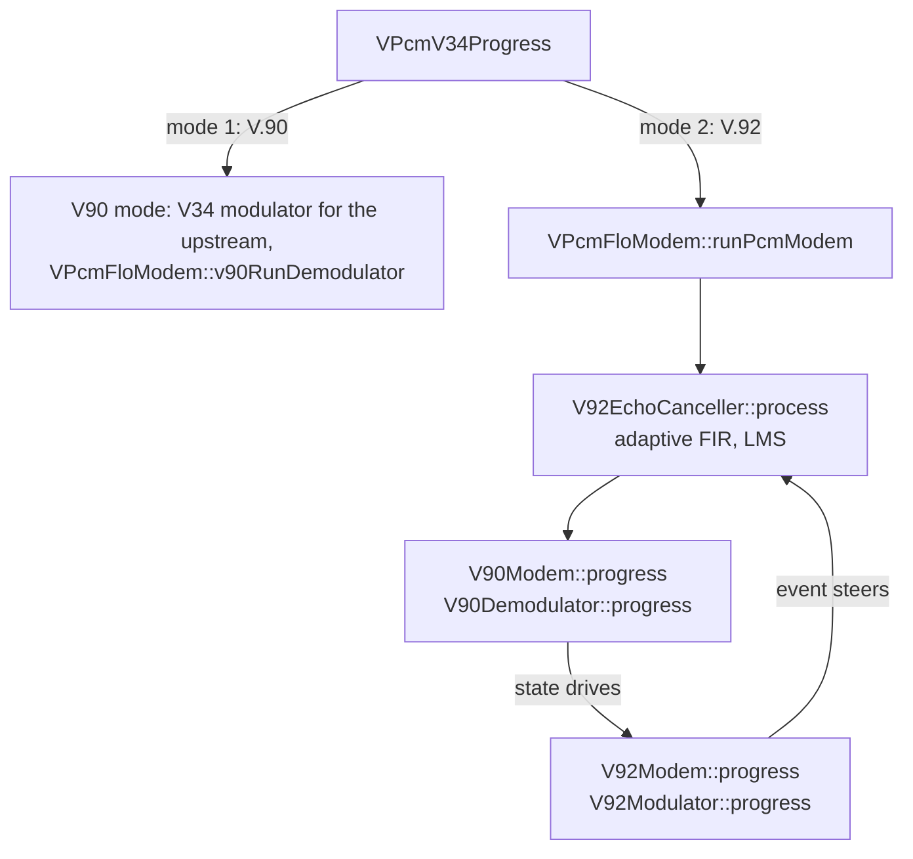

**Downstream receive** (`V90Demodulator::progress`, v90_demodulator_progress.cpp):

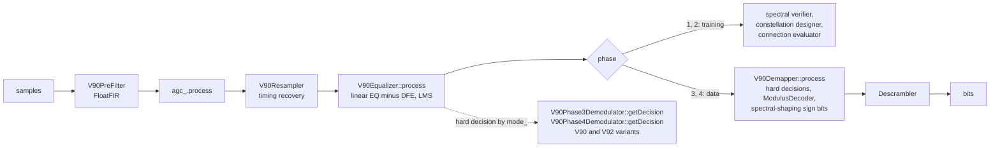

* The equaliser consumes two samples per symbol and takes its hard decision from the current training or data state: `V90Phase3Demodulator` covers Sd, TRN1d, ADID study, Jd and the DIL
  probing; `V90Phase4Demodulator` covers Ri, TRN2d, CP / MP, Ed and B1d.
* **Training aids:** `V90AutoDigitalImpDetector` (v90_adid*.cpp; mu-law / A-law and digital pad-gain detection), `V90ConstellationDesigner` (v90_constellation_*.cpp; picks the
  six per-phase u-code lists that `V90CPPacker` sends upstream in the CP frame), `V90TRN2Designer` (v90_trn2_designer.cpp), `V90ConnectionEvaluator` (verdicts: stay, rate up, rate down, retrain, fall back to V.34).
* **Frame codecs:** `V90MP`, `V90CP`, `V92CP`, `V90Jd` / `V92Jd`, `V90DIL` (v90_mp.cpp, v90_cp.cpp, v92_cp.cpp, pcm_jd.cpp, pcm_dil.cpp).

**V.92 upstream transmit** (`V92Modulator::progress`, v92_modulator.cpp), states 0 silence, 1 phase 3 (Ja, Ru, Su, TRN1u), 2 phase 4 (CPu, SUVu, TRN2u, Ed), 3 data:

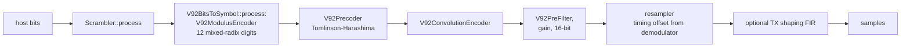

The digital-side chain that is *not* used by the pump: bits → `ModulusEncoder` (six digits) → mu-law / A-law level table → `sde_` differential encoder or `V90SpectralShaper` (a trellis over sign patterns) → six PCM symbols per frame.

### Fax (`fax`)

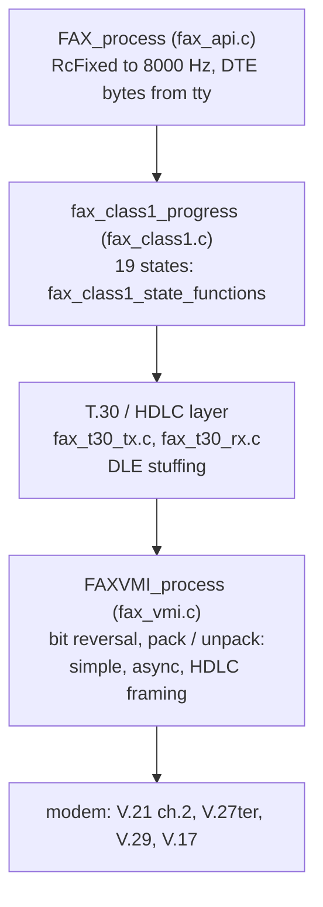

| modem | transmit | receive |
|---|---|---|
| V.21 channel 2 | `V21TX_modem` → `ModDataV21`: `FPM_FSM_modulate`, `FPM_MRF_filter` | `V21RX_modem` → `DemodDataV21`: AGC, tone detect, MRF, `FPM_FSD_demodulate` |
| V.27ter | FIFO → `ModDataV27`: `SDMv27_scrambler`, `SMC_encoder`, `FAXPPS_filter` | AGC, tone detect, `FPM_MRF_filter`, `FAXSRE_recover`, `FAXFSE_receive`, descramble |
| V.29 | FIFO → `ModDataV29`: scrambler, `SMC_encoder`, `FAXPPS_filter` | as V.27ter |
| V.17 | FIFO → `ModDataV17`: `SDM_scrambler`, `SMCv17_encoder_dif` / `_abs` / `_tcm`, `FAXPPS_filter` | as V.27ter plus `FAX_FSE_decision_*pt` → `FAXVTB_decoder` (Viterbi, shared with V.32) |

Training patterns (TEP, AB, EQ conditioning, SCR1) come from the state handlers and `SGD_sequence_gen` / `SGD_symbol_gen` (fax_fifo_sgd.c).  The shared files are
fax_timing.c (`FAXSRE_recover`), fax_equalizer.c (`FAXFSE_receive`), fax_pulse_shaping.c (`FAXPPS_filter`), fax_scrambler.c, fax_v17_viterbi.c.

### Voice (`voice`)

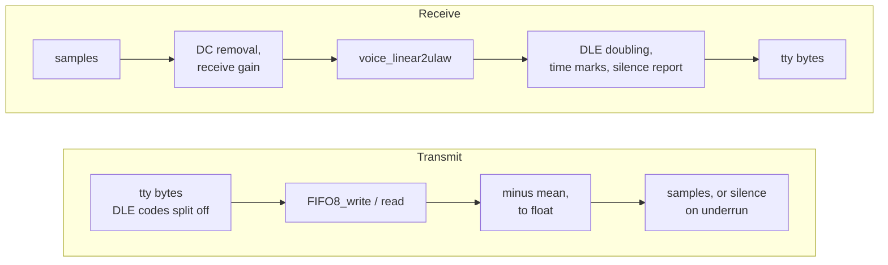

`VOICE_process` resamples the line to 8000 Hz, runs `voice_modem`, then resamples back.  `voice_modem` first runs the detectors (DTMF, four `TONE_detect` objects for 1296, 1100, 2100 and 2225 Hz,
busy and dial cadence), then the mode handler `voice_online` / `voice_tx` / `voice_rx` / `voice_duplex`.  Tones are generated per sample by `beepgen_sample`.

### Call progress, ring and caller ID

Not part of any data pump's chain: call progress (`call_run` → `CALLPROG_Progress`, tone detection and dialling at 8000 Hz) is its own pump; the ring detector (`RingDetector`, src/ring) runs from
`RD_process` in core/dp_runtime.c; caller ID (`CID_process` → `cid_modem`) is DC removal → 1200 Hz seizure detect (`FPM_MTD`) → `FPM_MRF_filter` 8000 → 7200 Hz → AGC → FSK demodulator → byte framer.
The tone-detect core in src/tone (`ToneIir` band-pass plus the `Cadence` recogniser) is shared by call progress and voice.

## Object and handle conventions

* **Typed objects with the i386 layout pinned.**  Every object `dsplibs` allocates is a C struct / C++ class whose members sit at `dsplibs`'s
  i386 offsets.  The offsets are asserted at compile time: `_Static_assert` blocks next to the struct (e.g. `ring/ring_detector.h`), or the
  generated `*_layout.inc` fragments (35, `DSP_ASSERT_LAYOUT_I386`, written by tools/layout_gen.py from `layouts/<module>/<name>.layout`), active on
  i386 only.  On x86-64 pointer members widen; where two descriptions of one object must agree there, static asserts tie them.  The V.34 object has
  ONE definition: the generated C struct `src/v34/v34_object_view.h`, which is the plain-C `V34Obj` and the C++ `tagV34Object` at once; its sub-objects
  `rx` (with `blkb`), `mod` (with `pf`), `tx`, `echo0` / `echo1`, `det`, `rate`, `probe` are named members whose structs in `v34_subobjects.h` are the
  only definition of their members (`obj->rx.rxFlags_`, no flat duplicate).  `tools/layoutscan/` checks every such pair.  Unknown regions keep
  neutral names (`unkXXXX_`, `reservedA`); never an offset presented as a meaning.
* **Table handles** (`core/dsp_table_handles.h`).  `dsplibs`'s config blocks are arrays of 32-bit words, some holding the address of a table.
  `CFGP(sym)` is that address on i386 and a small handle on x86-64; consumers read `cfgp_ptr(word)`.  A table symbol is registered in the
  `CFGP_SYMS_<file>` list of its defining file.
* **Member access.**  New code uses plain `p->member` / `p->arr[i]`, never an offset or cast accessor, and addresses are pointers (a parameter that
  holds an address is a pointer, `char *` for the flat V.32 / V.8 byte-offset objects), not integers.  The accessor macros of `core/dsp_access.h`
  remain only where plain access cannot say what the code does: a member declared with one type but read as another (`MEMBER_AS(T, p, m)`, with
  `_AT` / `_ATB` for `p + K + i * 2` / `p + i * 2 + K`; sign and width views), sub-object base addresses (`MEMBER_AS_OF`, `MEMBER_ADDR*`,
  `MEMBER_DISTANCE`, `MEMBER_ADDR_VIA`), element-indexed bases (`MEMBER_IDX*`, `MEMBER_AS_PIDX`, `MEMBER_ELEM_FLAT`) and pointer slots that are not
  yet real pointer members (V.8 `V8_PGM` / `V8_PSM`; V.32 `V32?_PG` / `_PS`, `SRE_*`, `PPS_*`, `ECC_*`; Bell 103 `B103_W` / `B103_PSTORE` /
  `B103_PLOAD`; the type-punned `FPM_M` of fpm / fsk).  The V.34 files use `obj->member` and the unsigned views `AS_U16(lv)` of `v34_access.h`;
  its `S16T` / `U16T` / `S32T` / `U32T` / `OBJ_BYTES` / `V34OFF*` family survives only for untyped records, halves of 32-bit members and walks over
  adjacent single words.  The offset in every accessor comes from the struct.
* **Asm idioms** (`core/dsp_asm.h`).  Every inline-asm statement that pins `dsplibs`'s code is a named macro: `COMPILER_BARRIER()`,
  `OPTIMIZER_HIDE_VAR(v)` / `_MEM` / `_X87`, `KEEP_STORES_TO(p)`, `NO_TAIL_CALL()`, and the x87 family (`X87_LOAD_F32` ..., `X87_SIN`,
  `X87_YL2X`, `X87_FISTP_I64`, ...).  The only other `__asm__` in src/ are symbol-name bindings (`__asm__("name")` on declarations).  The
  x87 math helpers that keep `dsplibs`'s extended precision are `core/dsp_math.h`; `core/dsp_cxx.h` has `DSP_STATIC_ASSERT` and
  `DSP_ASSERT_LAYOUT_I386`.
* **Named constants.**  State machines use enums next to their structs (the vpcm modulator / demodulator states, `FaxClass1State`, `CallProgState`, the
  fax modem states ...); two are generated from name tables in the sources: `V34HsState` (`src/v34/v34_hs_states.h`, tools/v34_hs_states_gen.py)
  and `V8Status` (`src/v8/v8_status.h`, tools/v8_status_gen.py).  Shared numbers are macros: `src/v34/v34_symbol_rates.h` (V.34 baud and carrier
  codes) and `src/core/dsp_constants.h` (data rates `RATE_*`, sample rates `SAMPLE_RATE_*`).  A name stands only where the member / parameter is known
  to hold that quantity (the same number is also a tone frequency, a count, an offset).
* **Generated files** are committed and say so in their first line: the layout fragments (tools/layout_gen.py), the V.34 C views (tools/tier_rewrite.py),
  the V.34 handshake state enum and the V.8 status enum.  `tools/check_generated.sh` verifies that all of them are up to date.  The parameter regions of
  the PCM parameter classes (`pcm_parameters*.{h,cpp}`, `layouts/vpcm/pcm_parameters.layout`) and some coefficient tables were extracted from the
  `dsplibs` binary by scripts that are not part of this library.
* **The V.8 / V.32 struct definitions and member accessors** (src/v8/v8.c, v8_obj.h, src/v32/v32*.c, v32.h) were first produced by a generator that
  is retired; these files are hand-maintained.

## The host interface

The library has no dependency on its host's sources.

1. **Host headers.**  None are needed.  The data the host and the library share (`enum DP_ID`, `DPSTAT_*`, `struct dp` / `dp_operations` / `dsp_info`,
   `struct voice_info` / `enum VOICE_CMD`, the fax and voice status codes, the `MDMPRM_*` / `Get*` parameter ids) is declared in the library's own,
   freestanding `src/core/host_interface.h`, with the layout and numeric values of slmodemd's interface; the host functions are in
   `src/core/dsp_host.h`.  How another host maps to them: `docs/host-interface.md`.  `tools/hostids_check.sh` checks that the header is freestanding
   (the C++ files include it).  The optional `tools/hostiface_check.sh` compares it with a host's headers (values, sizes, offsets, prototypes; -m32
   and -m64); it runs only when `HOST_INCDIR` names a directory holding `modem_defs.h`, `modem_dp.h` and `modem_param.h`, and is skipped otherwise.
2. **Host functions at link time** (21): `sysdep_malloc`, `sysdep_free`, `sysdep_memcpy`, `sysdep_memset`, `sysdep_sprintf`, `sysdep_strcat`,
   `sysdep_strcpy`, `sysdep_strlen`, `sysdep_vsnprintf`, `dsplibs_debug_printf`, `dsplibs_debug_level`, `modem_dp_register`,
   `modem_dp_deregister`, `modem_get_param`, `modem_set_param`, `modem_get_sreg`, `modem_get_bits`, `modem_put_bits`, `modem_send_to_tty`,
   `modem_recv_from_tty`, `modem_debug_log_data`; plus libc (`abort`, `fwrite`, `stderr`, `memmove`, `memset`).
3. **Entry points.**  slmodemd declares the 22 entry points itself (see the top of this page); no library header crosses to the host.  `make install`
   installs `host_interface.h` as `include/dsplib/host_interface.h`.  A public header for the entry points (`include/dsplib/dsplib.h`) does not exist
   yet: it needs the prototypes exactly as defined (note `RD_ring_details(void *, long *, long *)`) and the host types above (or opaque handles).
4. **Build.**  `make [BITS=32|64]` builds `obj$(BITS)/libdsplib.a` (the recipe is `dsplib.mk`, the sources `sources.mk`, the pinned flags `flags.mk`);
   link it after the host's objects with `-lstdc++ -lm`.  The archive's member order is the order of `sources.mk`.
